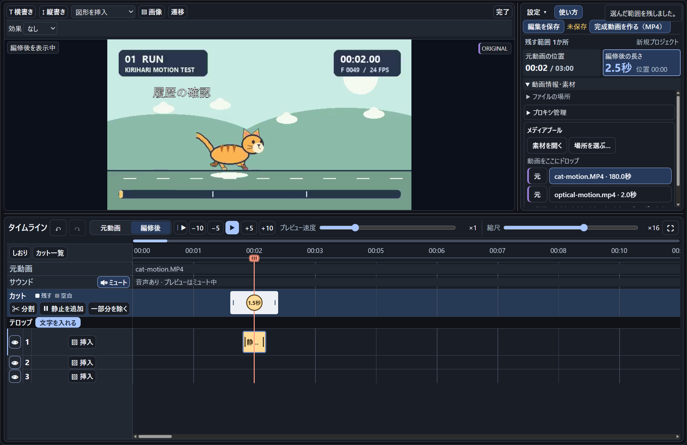
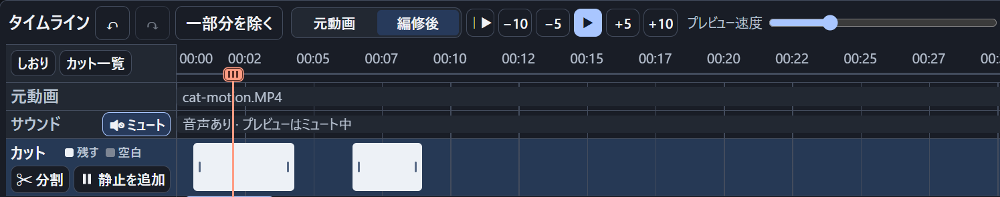
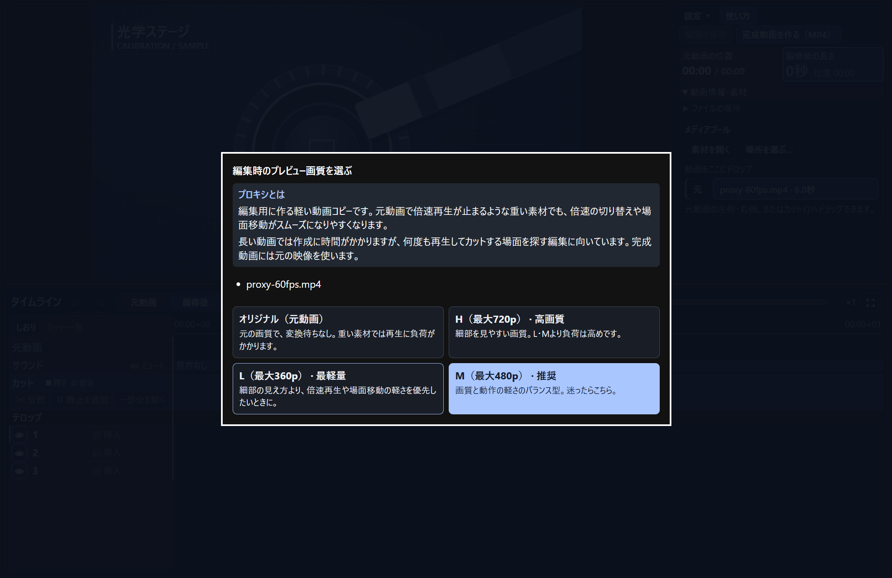
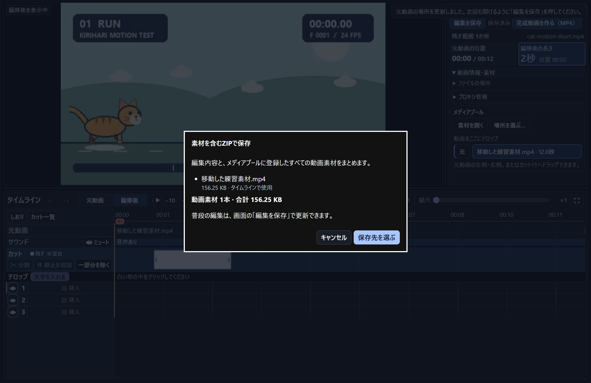

# KIRIHARI

**動画を切って、説明を貼る。** 学会発表、授業、研究記録、操作説明のためのWindows向け動画編集アプリです。長い録画から見せたい場面を拾い、映像を止めて文字や矢印を重ね、説明付きのMP4にまとめられます。

[GitHub Releases](https://github.com/UroCo-lab/KIRIHARI/releases) · [クイックスタート（PDF・2ページ）](docs/KIRIHARI-クイックスタート.pdf) · [初回セットアップ](docs/SETUP.md)

*1.8.17の編集画面。白い帯が残す範囲、丸印が映像を止める位置、黄色い帯が静止中に出すテロップです。右側に編修後の長さが表示されます。*

## どんな動画を作れるか

| 使う場面 | 編集の例 |
| --- | --- |
| 学会・研究発表 | 長い記録から見せたい場面を拾い、説明したい瞬間を数秒止める。矢印や短い注釈を重ね、スライドに入れやすいMP4にする。 |
| 授業・操作説明 | 画面録画から待ち時間を外し、操作箇所を図形で囲む。別撮りした補足映像を途中に差し込み、各手順に文字を添える。 |
| 長い録画の要点整理 | 倍速プレビューとしおりで候補を探し、必要な場面だけをつなぐ。編集データを保存して、後日編集を再開する。 |

## 編集の流れ

### 残す場面を選ぶ

タイムラインの **カット** 行で、使いたい範囲をドラッグすると白い帯になります。複数の帯を作ると、**編修後** のプレビューでは残した範囲が順につながります。帯の端で範囲を調整でき、**一部分を除く** では除外前後の完成尺や関連するテロップ・静止への影響を確認できます。元動画を再生しながら **K** を2回押して範囲を指定することもできます。プレビュー速度を変えた直後や、記録の途中で速度を変えた場合もKを使えます。

別の動画はメディアプールからカット行へドラッグして差し込めます。差し込みの前後は、専用のプレビューを見ながら詰められます。 [差し込み動画の調整画面](https://raw.githubusercontent.com/UroCo-lab/KIRIHARI/main/docs/screenshots/insert-trim.png)

### 映像を止めて説明を重ねる

白い帯の中で **文字を入れる** を押すと、画面上に文字を直接入力できます。横書き・縦書き、矢印や吹き出し、画像を組み合わせ、表示する長さや入り方・消え方を調整できます。

**静止を追加** は、指定した位置で映像を指定秒数だけ止めます。静止中だけテロップを出すこともできるので、動きの速い場面で見る場所を示せます。完成動画でゆっくり見せたいカットは、カットごとに0.1〜16倍の倍率を指定できます。

### 長い素材から見たい位置を探す

プレビューは0.1〜32倍、タイムラインの縮尺は1〜100倍で調整できます。**しおり** には元動画の位置とメモを記録でき、**カット一覧** から開始時刻や素材名で探して、その場面へ移動できます。

重い動画には、編集時のプレビュー用に軽いコピーを作る **プロキシ** があります。元動画・H（最大720p）・M（最大480p）・L（最大360p）から選べます。変換中も元動画で編集を進められ、MP4の書き出しには元動画を使います。

### MP4を書き出し、編集を残す

**完成動画を作る（MP4）** では、完成尺、音声の有無、予測容量、保存先を確認できます。学会スライド向け、標準（フルHDまで）、元動画のサイズ・fpsを維持する設定、詳細設定から選べます。 [書き出し設定の詳細](#書き出し設定)

続きを編集するときは **編集を保存**、別PCへ移すときは **素材を含むZIPで保存** を使います。素材ZIPはメディアプールに登録した動画を編集データと一緒にまとめ、保存前に一覧と合計容量を確認できます。普段の編集で元動画を書き換えることはありません。

## ダウンロードと起動（1.8.18・確認用）

1.8.18の確認には、ローカルの **KIRIHARI-1.8.18-windows-x64.zip** を使います。公開版は [GitHub Releases](https://github.com/UroCo-lab/KIRIHARI/releases) から入手できます。**samples.zip** は追加の練習素材、**source.zip** とGitHubの **Source code** は開発用です。

1. 本体ZIPを右クリックして **すべて展開** し、書き込み可能で階層の浅いローカルフォルダで **KIRIHARI.exe** を開きます。EXEと同梱ファイルは同じフォルダに置きます。
2. 初回の **はじめの準備** で **必要な部品を準備** を押します。不足しているFFmpegなどを取得します。準備が済んだら **KIRIHARIを始める** を押します。
3. 起動画面で **練習動画で試す** を押すと、同梱の猫の動画（12秒）を編集できます。次回以降は起動画面の **メニュー** または編集中の **設定** から開けます。

Windows x64、.NET Framework 4.8以降、Microsoft Edge WebView2 Evergreen Runtimeが必要です。動作確認はWindows 11 x64で実施しました。Windows 10とWindows on ARMは未検証です。EXEは未署名のため、起動時にWindowsの警告が表示されることがあります。確認方法は [初回セットアップ](docs/SETUP.md) にあります。

展開から最初のMP4書き出しまでを [クイックスタート（画像付きPDF・2ページ）](docs/KIRIHARI-クイックスタート.pdf) にまとめています。

機能ごとの操作は [詳しい使い方（印刷用PDF・15ページ）](docs/KIRIHARI-詳しい使い方.pdf) を参照してください。どちらのPDFも、起動画面の **メニュー**、編集中の **設定** または **使い方** から開けます。

依存部品の手動導入やトラブル対処は [初回セットアップ](docs/SETUP.md) にあります。

本体の **samples/lightweight** には、猫（12秒）、差し込み（7秒）、光学ステージ（2秒）のMP4と「サンプル編集.kirihari」を収録しています。起動画面の **動画を選んで編集** や **前の編集を開く** から選べます。3分の猫を使う場合は任意の **KIRIHARI-1.8.18-samples.zip** を展開してください。

### 軽量の練習動画をダウンロード

猫とロケットの軽量MP4はGitHubから1本ずつダウンロードできます。

- [猫の練習動画（12秒・MP4）](https://raw.githubusercontent.com/UroCo-lab/KIRIHARI/v1.8.17/samples/lightweight/cat-motion-short.mp4)
- [ロケットの差し込み動画（7秒・MP4）](https://raw.githubusercontent.com/UroCo-lab/KIRIHARI/v1.8.17/samples/lightweight/insert-motion.mp4)

## AIに導入・改変を頼む

- **導入**するには、配布URLまたは本体ZIPと [INSTALL.md](INSTALL.md) をAIに渡します。同梱の `install.ps1` で新しいフォルダへ展開できます。
- **改変**するには、本体と同じ版の **KIRIHARI-1.8.18-source.zip** を別フォルダへ展開します。展開したソースと [AI_HANDOFF.md](AI_HANDOFF.md) をAIに渡し、変えたいことを伝えます。

> AI_HANDOFF.mdを読み、ノートPCの小さい画面でプレビューを広く使えるように調整してください。練習素材で動作確認し、修正版を別フォルダに作ってください。

変更箇所やビルド手順は [AI_EDITING.md](AI_EDITING.md) にあります。

## ライセンス

KIRIHARIの自作コード・文書・練習用素材は **MIT License** です。AIで改変した版も、著作権表示とMITの許諾文を添えれば、有償・無償を問わず再配布できます。改変版のソースを公開するかは配布する人が選べます。 [LICENSE](LICENSE)

アイコン、WebView2、FFmpeg、フォントの扱いは、依存部品と素材の案内に記載しています。 [THIRD-PARTY.md](THIRD-PARTY.md)

## 表示と操作の設定

**設定** は「プロジェクト」「表示・操作」「素材・フォルダ」「セットアップ」「練習・ガイド」に分けています。

**設定 → テーマ…** で5種類の配色を試して保存できます。マニュアルでは背景・パネル・文字・強調色・カット・テロップ帯を変更できます。Windows 11では、編集ウィンドウのタイトルバーにもパネルと文字の配色が反映されます。

テロップの図形を選ぶと **線の太さ** と **線のタイプ**（実線・点線・長い点線・二重線）を変更できます。図形や画像の **透過度** は0〜100%です。練習用の透過PNGとJPEGは `samples/lightweight/images` にあります。

**設定 → デフォルトのフォルダ…** で素材・プロジェクト・保存先を指定できます。通常の「開く」は指定先、指定がなければ前回の場所を開きます。**素材を開く…** や **名前を付けて保存…** では、デフォルト、プロジェクトファイルのある場所、前回使用した場所から選べます。MP4とプロジェクトZIPの保存場所は書き出し画面で変更できます。

## 静止位置と図形の調整

- 映像が静止する位置の印はカット内でドラッグして移動できます。ダブルクリック、または右クリックの **静止する位置を変更** で、元動画の時・分・秒・ミリ秒を指定できます。静止中だけのテロップも追従します。
- 図形は選択枠の上の丸いハンドルで回転します。Shiftで15度刻み。角度の数値入力、右／左へ90度回転、左右／上下反転も使えます。黄色い吹き出しハンドルは突起の先端です。

## 編集する

1. **動画を選んで編集** から **動画を選ぶ** か、動画をドロップします。素材が1本なら自動で選択されます。複数あるときはメイン動画を選びます。**編集を始める** を押すと編集画面が開きます。名前は任意で、空欄にすると「新規プロジェクト」になります。フォルダをドロップすると子フォルダを含むMP4を登録します（大文字拡張子に対応、重複を除き最大100本）。
2. **カット** 行で残したい範囲をドラッグします。帯をまたいでドラッグすると、その間の空いている区間が追加されます。白い帯は両端で調整できます。途中を外すには、カット行の **分割** や **静止を追加** と並ぶ **一部分を除く** を押し、不要な範囲をドラッグします。赤い範囲、前後の完成尺、テロップ・静止への影響を確認してから **この部分を除く** を押します。複数の帯にまたがる操作もまとめて1回で取り消せます。
3. 白い帯の中へ赤い線を移し、**テロップ** の隣の **文字を入れる** を押すと何度でも直接入力できます。新規の文字は細い黒縁付きで、書式の **黒縁** で切り替えられます。空のスライドを作るにはテロップ行の **挿入** を使います。初期の長さは約3秒が目安です。帯が細くなる場合は、現在の表示倍率に合わせて長くします。カットの終端までの残りが短い場合は、そこで止まります。**遷移** でスライドの入り方と出方を設定できます。
4. **元動画** と **編修後** で再生対象を切り替えます。プレビューに表示中の動画が示され、対応する時刻欄も強調されます。**ミュート** と再生速度はプレビューに適用されます。後から編集を再開するには **編集を保存** を押します。
5. **完成動画を作る（MP4）** を押し、完成尺・音声・保存先を確認します。**用途・画質** で **標準** や **学会スライド向け** を選べます。サイズやフレームレートは **出力仕様** で確認できます。**元の音声を入れる** でMP4の音声を選び、**書き出す** を押します。新規編集は元の音声を入れる設定で始まり、旧プロジェクトは従来の書き出し時の音声設定を引き継ぎます。

**元動画** の再生中に **K** を押すと、完成動画に残す範囲の記録が始まります。仮の帯は再生位置に合わせて左右に伸び、もう一度 **K** を押すと2点の間が確定します。既存カットや複数の元動画をまたぐ場合は、空いている区間を埋めます。既存カットの倍率・静止・テロップや差し込みはその位置で使います。Kで追加した区間は **元に戻す** でまとめて取り消せます。

再生中に確定すると、そのまま再生が続きます。一時停止やシークのあとや、元動画の終端でも確定できます。つまみにフォーカスがあると、矢印キーで1フレームずつ調整できます。そのまま **K** で確定、**Esc** で取り消せます。キーは **設定 → ホットキー** で変更できます。

時間目盛りの左にある **しおり** から、元動画の現在位置にメモを付けられます。一覧の時刻を押すと、元動画に切り替わってその場面で一時停止します。メモは一覧で変更できます。Kで範囲を記録中に **しおり** や **使い方** を開いても、最初にKを押した位置は保持されます。しおりを保存したプロジェクトは1.8.8以降で開けます。

時間目盛りの左にある **カット一覧** で開始時刻・素材名・完成尺・倍率を確認できます。検索欄には `１：０３` や `1時間3分15秒` のほか、`猫 2倍` のように空白で区切って複数の条件を入力できます。**移動** はカットの先頭に移り、**拡大** は両端が見える縮尺に切り替えます。カット帯の右クリックでも拡大でき、**全体表示** でタイムライン全体に戻ります。

**縮尺** のスライダーで1〜100倍を連続調整できます。拡大中は、時間目盛りのすぐ上のゲージが、全体のうち表示中の区間を示します。目盛りや元動画の行を横にドラッグすると、表示位置とゲージが連動します。

ウィンドウが狭いときは、倍率付きの **速度** と **縮尺** ボタンに切り替わります。ボタンにマウスを置くか押すと、スライダーを開けます。縮尺のポップアップには **全体表示** もあります。

メディアプールの素材を元動画の行にドラッグすると、左半分では **先頭に追加**、右半分では **末尾に追加** が強調されます。カット行にドラッグすると、素材の長さを表す帯になります。

差し込みの帯はドラッグで移動します。前後を短くするには、帯を右クリックして **カット** を開き、プレビュー下の帯の両端を動かします。画面の見出しをドラッグすると、背後のタイムラインを見ながら調整できます。帯が重なった場合は赤く表示されます。移動や前後のカットで重なりを解消すると、カット再生とMP4書き出しができます。

テロップの帯を右クリックすると、編集、表示切替、コピー、カット、貼り付け、削除が選べます。貼り付け先のテロップ行で右クリックすると、その位置に貼り付けられます。

静止の位置をまたぐテロップの両端を内側へ寄せると、静止の位置で止まります。両端を同じ位置に合わせると、タイムライン上で静止の印と同じ黄色の **静止中** の帯になり、映像が静止している間だけテロップが表示されます。短い帯もクリックして編集でき、プレビュー・MP4・保存と再読込に対応します。静止を削除した場合は、その位置の1フレームのテロップへ戻します。

完成時間と残す範囲の数は動画情報の上に表示されます。メディアプールは **動画情報・素材**、元動画と出力先のパスはその中の **ファイルの場所** で確認できます。

空のテロップ行は低く表示されます。テロップを追加した行は自動で広がり、最後のテロップを外すと元の高さに戻ります。使用中の行の高さは **設定 → タイムラインの行** で調整できます。小さい画面ではプレビューの高さを優先するため、下の行はタイムライン内をスクロールして表示します。仕切りを上にドラッグするとタイムラインを広げられます。

動画情報の上にある **使い方** から、クイックガイドを開けます。

**↶／↷**、**Ctrl+Z／Ctrl+Y（Ctrl+Shift+Z）** で編集を取り消し・やり直しできます。文字入力中は入力欄の取り消しが働きます。履歴は起動中のみで、データ量に応じて最大50回程度です。

カットの端をダブルクリック、または右クリックの **開始・終了時刻を指定** から、元動画の時刻で範囲を指定できます。**時・分・秒・ミリ秒** を直接入力するほか、上下ボタンと上下キーで増減できます。**Tab** で次の数値欄へ進み、開始のミリ秒の次は終了の時に移ります。**Shift＋Tab** で前の欄に戻れます。1時間3分15.4秒は「時1・分3・秒15・ミリ秒400」です。開始と終了を逆に入力した場合は、早いほうを開始として適用します。指定するのは1つの素材の範囲内で、素材のフレーム単位に丸めます。

カット帯を右クリックして **完成動画のカット倍率** を選ぶと、そのカットだけを **0.1〜16倍** に変更できます。倍率は編修後のプレビューとMP4に反映され、テロップは映像に追従します。静止は指定した時間で保持します。倍率を変更したプロジェクトは1.8.7以降で開けます。

テロップを編集して **遷移** を開くと、**入る時間／出る時間** をそれぞれ0.01〜60秒で設定できます。短くすると素早く、長くするとゆっくり表示・非表示になります。±ボタンは0.1秒ずつ調整します。短い表示区間では指定比率を保って短縮し、実際の時間を表示します。設定はプレビュー・MP4・保存・Undo/Redoに反映します。旧版の共通秒数も読み込めますが、個別時間の編集には1.2以降を使用してください。

プレビュー脇の **編修後の長さ** で、残す範囲とポーズを合わせた完成尺を確認できます。編修後の現在位置はその横に小さく表示されます。

**編集を保存** の横で保存状態を確認できます。新規プロジェクトは初回の手動保存まで **保存前** と表示されます。編集を加えると **未保存** になります。保存せずにウィンドウを閉じると、カット前でも保存するか確認します。異常終了した場合は次回起動時の自動保存候補から復元できます。**復元_** で始まる新しいプロジェクトとして開くため、復元後に保存してください。自動保存は直前の全操作を保証するものではありません。書き出し完了後は **完成動画を見る／保存先を開く** で結果を確認できます。

未保存の編集から別の編集に移るときは **保存して切り替える／保存せず切り替える／キャンセル** を選べます。元動画を移動した編集を開くと、見つからないファイルを選び直す画面が出ます。旧版の編集ファイルでは、選んだ候補の映像・長さ・解像度を確認します。開いたあと **編集を保存** を押すと新しい場所を記録します。

別のPCへ持ち運ぶときは **設定 → 素材を含むZIPで保存** を使います。タイムラインに置いていない動画も含め、メディアプールの全素材と合計容量が保存先を選ぶ前に表示されます。移動先で **前の編集を開く** からZIPを選びます。保存・読み込み中は進捗を確認し、必要なら **中止** を押せます。普段の編集ファイルの更新は **編集を保存** で行います。

## 重い動画を編集する

**プロキシ**は編集用に作る軽い動画コピーです。元動画で倍速再生が止まるような重い素材でも、倍速の切り替えや場面移動がスムーズになりやすくなります。長い動画では作成に時間がかかるため、何度も再生してカット箇所を探すときに向いています。

負荷が高い素材を読み込むと、**オリジナル（元動画）／H（720p）／L（360p）／M（480p・推奨）** からプレビュー画質を選べます。動画を選ぶ画面で素材名の左にある画質ボタンを押すと、ほかの素材でも同じ選択肢を表示できます。編集開始後は、プレビュー右上の画質マークから切り替えられます。

細部を確認するなら **H**、倍速再生や場面移動の軽さを優先するなら **L**、迷ったら画質と軽さのバランスを取った **M** が目安です。選択画面の各ボタンに違いを表示します。

プロキシ変換中は、動画を選ぶ画面と編集画面の上部に進捗バーを表示します。変換が済むまで元動画で編集する場合は、操作が重くなることがあります。完了するとプレビューは自動で選んだプロキシに切り替わります。途中で画質を選び直した場合は、その選択が優先されます。

**動画情報・素材 → プロキシ管理** では、素材別に画質を使用・再生成・削除できます。生成中は進捗と中止ボタンを表示し、同じ画質を再生成している間は旧コピーを使えます。元動画を変更したときはプロジェクトを開き直してから再生成してください。

編集用コピーはH.264/MP4で、元動画の高さを基準に比率と表示時刻を保って縮小します。元動画より大きく拡大せず、元のフレームレートを維持します。デコーダーが補える破損箇所は変換を続けます。その箇所の表示が乱れることがあり、時刻を照合できない場合は現在の画質を維持します。キャッシュはアプリ内の `data/proxies` に置き、書き出しとプロジェクトZIPには元動画を使用します。旧版のキャッシュも合計容量に含まれます。

カット内に再生位置を置き、**静止を追加** で映像を止める秒数を指定します。プレビューとMP4は、円の位置で指定時間だけ映像を静止し、その間の音声を無音にします。静止の円やカットの帯は右クリックから削除できます。

時間目盛りをクリックすると、再生を止めてその位置へ移動します。赤いつまみを左右にドラッグすると、停止したままプレビューが追従します。つまみを選んで矢印キーを押すと1フレームずつ移動します。**一時停止** は再生位置を保持し、**│▶** でオリジナルの先頭または最初に残したカットから再生できます。

再生速度は **0.1・0.5・1・1.5・2・4・8・16・32倍** から選べます。再生中は **↑／↓** で同じ刻みの速度に切り替え、**←／→** で戻る・進むことができます。32倍は映像を間引く無音のプレビューです。送り戻しは「元動画」または「編修後」の再生時間に対し、小さいボタンが約0.5%（最低5秒）、大きいボタンと左右キーが約1%（最低10秒）です。

**設定 → ホットキー** で割り当てを変更できます。再生／一時停止、テロップを入れる、ここから残す、カットを分割、静止を追加は初期状態で未割り当てです。キーを割り当てると停止中にも使えます。

**設定 → 送り戻しの幅** では、小ボタンと大ボタン・ホットキーごとに割合と最低秒数を変更できます。割合を0%にすると固定秒数になります。

**編集を保存** で編集を更新できます。管理されたプロジェクトはアプリ配下の `data/projects` に保存します。書き出し後の **プロジェクトZIP・作業フォルダ** を開くと、素材込みのZIP保存と作業フォルダの削除ができます。再開するには起動画面でプロジェクトを選ぶか、編集ファイルまたはZIPを開きます。未保存の編集がある場合は、アプリを閉じる前に保存を確認します。

元動画の内容は変更せずに扱います。編集の自動保存、プレビュー用コピー、書き出しの中間ファイルはアプリ配下の `data/work` に作ります。出力先の初期値は `output` です。古いUI試作形式の編集ファイルは `KIRIHARI.exe --classic` で開けます。

## 対応範囲と制限

- 標準出力はH.264 / MP4です。音声を残す場合は、各素材の最初の音声トラックをAACに変換します。1.0の編集は1.1でも開けます。ポーズ専用テロップを含む保存は新形式（kirihari-video-2）になり、1.1以降で開きます。旧版がテロップを欠落させて開くことを防ぎます。
- カットは素材の平均フレームレートに基づきます。可変フレームレート素材での厳密なフレーム一致、HDR、長時間素材の性能は今後の検証対象です。
- 再生速度スライダーはプレビューの確認に使います。カットごとの倍率と静止時間は編修後のプレビューとMP4に反映します。

## 書き出し設定

| モード | 設定 |
| --- | --- |
| オリジナルのサイズ・fpsを維持 | メイン動画の解像度・fpsを維持（縦横は必要なら偶数に調整）。品質一定で再エンコード。元データの完全コピーではありません。 |
| 学会スライド向け | 長辺1280・短辺720、30 fps上限。映像3 Mbps / 音声128 kbps。埋め込みの軽量化の目安です。会場の提出規定を優先します。 |
| 標準（フルHDまで・初期値） | 共有や動画投稿向け。長辺1920・短辺1080まで。元fps（60上限）。映像8 Mbps、30 fps超は12 Mbps / 音声384 kbps。 |
| 詳細設定 | 偶数の幅・高さ、1〜240 fps、映像0.1〜200 Mbps、音声64〜384 kbps。縦横比が違う場合は余白を付けます。設定を10件まで保存・更新・呼出・削除できます。 |

学会スライド向けと標準は小さい素材を拡大しません。各辺8192以下・合計約3355万画素までです。大きい動画の処理時間はPCに依存します。設定は本体のWebView2データ（data/webview内のlocalStorage）に保存し、プロジェクトやZIPには含めません。

容量予測はカットとポーズを含む完成時間から求める概算です。可変ビットレートのため実容量は内容によって変わります。オリジナル維持は元動画の平均データ量からの参考値で、大きく変動します。

## ビルドとテスト

    .\build.ps1
    .\build.ps1 -Test -VideoTest -WindowTest -Package -AppFolder KIRIHARI-1.8.18

Windows x64上のPowerShellと.NET FrameworkのC#コンパイラを使用します。初回ビルドは固定バージョンのMicrosoft WebView2 SDKをNuGetから取得します。 `-VideoTest` と `-WindowTest` はFFmpegとWindows上のWebView2 Runtimeを使います。実行ファイルは `dist/KIRIHARI`、テスト結果は `dist/qa`、`dist/video-qa`、`dist/window-qa` に出力されます。

`-Package` は配布用ZIPとチェックサムを `dist/release-<版>/` にまとめます。同じ版の既存ZIPとソース・同梱物の内容が一致した場合は既存の一式を再利用し、差があれば停止します。

- [変更履歴](CHANGELOG.md)
- [依存関係と配布条件](THIRD-PARTY.md)
- [検証記録](docs/verification.md)
- [公開準備・手順](docs/PUBLISHING.md)
- [Release説明文](docs/RELEASE-NOTES-1.8.18.md)
- [旧UI試作の設計](docs/design.md)
