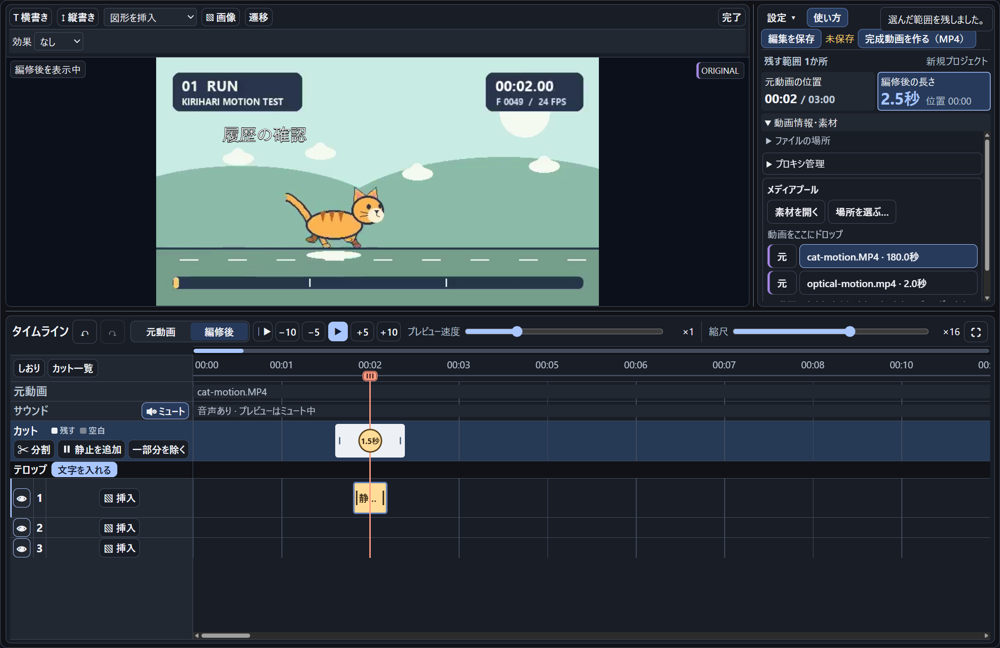

# KIRIHARI 1.8.18（確認用）

KIRIHARIは、学会発表や授業、操作説明に使う短い動画を作れるWindows向け編集ソフトです。録画から必要な場面を選び、映像を止めて注釈を出し、音声付きまたは音声なしのMP4に書き出せます。

[画面付きの機能紹介](https://github.com/UroCo-lab/KIRIHARI#編集の流れ)

## 1.8.18での変更

- 元動画の再生中に速度を変更したあとも、**K** で残す範囲の記録を始め、もう一度 **K** で確定できます。狭い画面の速度ポップアップでも動作します。
- 猫とロケットの軽量な練習動画を1本ずつ取得できるリンクを追加しました。

## この版でできること

- **残したい場面をドラッグで選ぶ。** 白いカット帯を複数作ると、残す範囲だけが完成動画につながります。途中の除外や別動画の差し込みにも対応します。
- **見てほしい箇所を説明する。** 映像を指定秒数止め、その間だけ文字や矢印を表示できます。横書き・縦書き、吹き出し、画像も重ねられます。
- **長い録画から場面を探す。** 最大32倍のプレビュー、しおり、カット一覧を使えます。重い素材はH・M・Lのプロキシでプレビューし、書き出しには元動画を使います。
- **発表や共有に合わせて書き出す。** 学会スライド向けや標準（フルHDまで）を選べます。再編集や移動用には、編集データと登録済みの動画を素材ZIPにまとめられます。

## ダウンロードと起動

1. Assetsから **KIRIHARI-1.8.18-windows-x64.zip** と **SHA256SUMS.txt** をダウンロードします。PowerShellで `Get-FileHash -Algorithm SHA256 -LiteralPath .\KIRIHARI-1.8.18-windows-x64.zip` を実行し、ZIPのSHA-256を記載値と照合します。
2. 本体ZIPを **すべて展開** し、書き込み可能で階層の浅いローカルフォルダで **KIRIHARI.exe** を開きます。初回は **必要な部品を準備** を押し、完了後に **KIRIHARIを始める** を押します。
3. **練習動画で試す** を押すと、同梱の猫の動画を編集できます。

展開から最初のMP4書き出しまでを、同梱の **クイックスタート（PDF）** で確認できます。機能ごとの操作は **詳しい使い方（PDF）** を参照してください。

本体はWindows x64向けです。Windows 11 x64で動作を確認しました。Windows 10、Windows on ARM、依存部品が未導入の別PCでの初回セットアップは未検証です。EXEは未署名のため、SmartScreenなどが警告を表示することがあります。

**KIRIHARI-1.8.18-samples.zip** は追加の練習素材、**KIRIHARI-1.8.18-source.zip** とGitHubの **Source code** は開発用です。

## 軽量の練習動画

猫とロケットの軽量MP4はGitHubから1本ずつダウンロードできます。

- [猫の練習動画（12秒・MP4）](https://raw.githubusercontent.com/UroCo-lab/KIRIHARI/v1.8.17/samples/lightweight/cat-motion-short.mp4)
- [ロケットの差し込み動画（7秒・MP4）](https://raw.githubusercontent.com/UroCo-lab/KIRIHARI/v1.8.17/samples/lightweight/insert-motion.mp4)

## AIに改変を頼む

本体と同じ版の **KIRIHARI-1.8.18-source.zip** を展開します。展開したソースと同梱の `AI_HANDOFF.md` をAIに渡し、画面や操作など、自分の環境に合わせて変えたいことを伝えてください。

KIRIHARIの自作コード・文書・練習用素材は **MIT License** です。改変版を配布するときは、著作権表示とMITの許諾文を含む `LICENSE` を添えてください。アイコンや外部部品の条件は同梱の `THIRD-PARTY.md` で確認できます。

画面付きの操作例と、保存・書き出し設定の詳細はREADMEで確認できます。 [KIRIHARIのREADME](https://github.com/UroCo-lab/KIRIHARI#編集の流れ)
